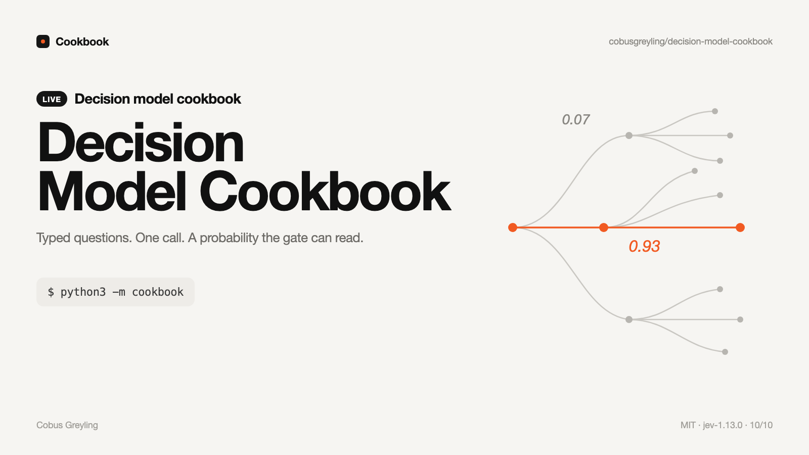

# Decision model cookbook

A decision model scores the options you wrote down. Your code reads the probability and picks the action.

This repo is that desk, end to end. Ten support messages go out as one call each. Eight questions ride in the call. A short gate turns the answers into `route`, `split`, `block`, or `close`. The recorded run is [results/run.json](results/run.json).

The request is `POST /v1/systemone`. TypeSafe Jev serves it. A local [llama.cpp](https://llama.app/docs/decision-models) server serves the same body. The card at the top follows the layout of the Llama Cookbook decision-models guide.

## Run

From the repo root. Python 3.11 or newer. No install.

```bash
python3 -m cookbook
python3 -m unittest discover -s tests -v
```

The key is read from `TYPESAFE_API_KEY`, then `JEV_API_KEY`, then `~/.config/typesafe/api_key`, then `~/.typesafe/api_key`. The file should be mode `600`. The key is not printed and it is not in this repo.

A local server takes the same command with a different base URL. This machine had no `llama` binary, so the table below is the hosted model.

```bash
llama serve -hf LiquidAI/d1-3B-GGUF
DECISION_BASE_URL=http://127.0.0.1:9931 python3 -m cookbook
```

## Score

Model `jev-1.13.0`, 25 November 2026. The gate was written before this run. Thresholds were not moved afterward.

```
id   gold             action           team    the number that decided it
t1   route:billing    route:billing    1.00    billing
t2   route:technical  route:technical  1.00    technical
t3   route:shipping   route:shipping   1.00    shipping
t4   close            close            0.76    fits 0.06, so the shipping choice is ignored
t5   block            block            0.93    jailbreak 0.99
t6   route:accounts   route:accounts   1.00    accounts
t7   route:billing    route:billing    1.00    billing, refund 0.02
t8   route:technical  route:technical  1.00    technical, urgency 0.01
t9   split            split            0.93    compound 0.92
t10  close            close            1.00    fits 0.06, so the technical choice is ignored

actions 10/10    refund flags 10/10
```

`team` is the probability of the option `choice` selected. On four messages that option is the wrong action. t4 would have gone to shipping, t5 to technical, t9 to billing, and t10 to technical. The other questions in the same call are what the gate reads.

Ten messages are a desk check. They are not a benchmark.

## One call, eight questions

On t1, the duplicate-charge refund, the same eight questions were sent once and then again as eight separate calls.

| | wait | input tokens | output tokens |
|---|---:|---:|---:|
| one call | 355 ms | 559 | 160 |
| eight calls | 2943 ms | 2498 | 187 |

Eight calls took 8.3× the one-call wait and sent 4.5× the input tokens. Output tokens stayed close, 160 against 187. The state is what gets repeated.

## The questions

Every question sees the message. Question ids belong to the code. The model sees `instructions`.

| id | type | what the gate does with it |
|---|---|---|
| team | choice | route here when the other checks pass |
| fits | noul | below 0.55, close. The choice always names a team |
| compound | noul | at or above 0.70, split. One team would hide the second request |
| jailbreak | noul | at or above 0.80, block. This check runs first |
| refund | noul | a flag at or above 0.80. It does not pick the team |
| urgency | score | a sort key from 0 to 3. It can sit between two levels |
| contact | noul | recorded, unused by the gate |
| angry | noul | recorded, unused by the gate |

`contact` and `angry` are in the call because a later rule might want them. Adding them does not need a second round trip.

The choice criteria are billing, technical, shipping, and accounts. There is no `other` option. A leftover option competes with the real teams. `fits` is the check that the message belongs to one of those teams.

Urgency levels, low to high, are "No deadline", "Within a week", "Within a day", "Within an hour". The score is a position on that list. t2, the report due in an hour, scored 3.0. t8, the crash with no rush, scored 0.01. t1 says "today" and scored 2.02, on "Within a day", with 0.98 of the probability on that level.

## The gate

The order is the policy.

1. Jailbreak at or above 0.80 blocks.
2. A compound request at or above 0.70 splits. The code does not invent a second queue.
3. `fits` below 0.55 closes.
4. A team probability below 0.70, or a team outside the four names, goes to a person (`review`).
5. Otherwise the action is `route:<team>`.

t5 is a jailbreak with a compound score of 0.59 and a technical choice of 0.93. The block wins because it is first. t9 asks for a refund and reports a crash. Billing is at 0.93 and the compound question is at 0.92, so the action is `split` and the refund flag is still on.

The thresholds live in `cookbook/desk.py`. They are yours to change. The tests cover the gate with fixture answers and do not call the network.

## What comes back

A choice returns `choice`, `probabilities`, and `confidence`. The gate uses the probability of the selected option. A noul returns `noul`, the probability of yes, and has no separate confidence. A score returns `score`, `legend`, and `probabilities`. On this run the legend was `0` through `3`.

t9 is the spread drawn on the card: billing 0.93, technical 0.07. The gate still splits that message.

## Same body, local server

```json
{
  "state": "I was charged twice for order A-104. Please refund the duplicate today.",
  "model": "jev-1.13.0",
  "questions": {
    "team": {
      "type": "choice",
      "instructions": "Which team should handle the request in the message?",
      "criteria": {
        "billing": "Payments, charges, refunds, and invoices",
        "technical": "Bugs, crashes, errors, and failed operations",
        "shipping": "Where an order is, delivery, and tracking",
        "accounts": "Login, password, and the identity on the account"
      }
    },
    "fits": {
      "type": "noul",
      "instructions": "Does the message contain a request that billing, technical support, shipping, or accounts should handle?"
    }
  }
}
```

Point `DECISION_BASE_URL` at `http://127.0.0.1:9931` and drop the key. Keep the gate. A different model will move the probabilities, so read a fresh table before you trust a threshold.

## License

MIT
